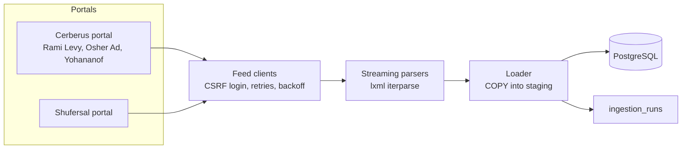

# SalSmart: grocery price comparison on official data

Israeli supermarket chains are required by the price-transparency rules to publish the full price list of every store, every day, as public XML files. Almost nobody uses them directly: the files come from several portals, in different formats and encodings, tens of megabytes per chain.

SalSmart downloads those files, normalizes them into one database, and (in the next phases) lets shoppers search a product across chains, compare a whole basket in their city, and get an alert when a price drops.

> **Status:** Phases 1-2 of 5. Ingestion, the API and the React UI work. The [live demo](https://saharhalili95.github.io/price-comparison-platform/) runs without a server on a real snapshot of about 300 products from 5 stores per chain (`backend/scripts/export_demo.py`).

## What the data looks like

Measured on 2026-10-21 from Israel:

| Chain | Portal | Stores loaded | Prices loaded | Time | Result |
| --- | --- | --- | --- | --- | --- |
| Rami Levy | Cerberus | 99 | 1,009,948 | 122 s | success |
| Yohananof | Cerberus | 48 | 477,134 | 62 s | success |
| Osher Ad | Cerberus | 25 | 154,274 | 22 s | success |
| Shufersal | own portal | 0 | 0 | 135 s | failed: the portal timed out on every retry, recorded as a failed run |

- **Totals:** one run of the three working chains stored **1,641,356 current prices** for **39,812 items** in **174 stores**, in a 491 MB database.
- **Re-runs add nothing:** running Yohananof again the same day recorded **0 price changes**, so the history did not grow.
- **Files are large:** one store's full price file is about 13,000 items and 10 MB of XML.

Real-world quirks the parsers handle, all found in these feeds:

| Quirk | Example |
| --- | --- |
| Two XML dialects, sometimes within one chain | `ChainID`/`StoreID` "034" vs `ChainId`/`StoreId` "34"; `ItemName` vs `ItemNm`; `2026-05-10T11:36:13.000` vs `2025-01-19 16:03:55` |
| Encodings | Store files in UTF-16, price files in UTF-8 |
| Compression | gzip, and zip archives with a `.gz` name |
| File names | `PriceFull<chain>-<sub>-<store>-YYYYMMDD-HHMMSS.gz` and `pricefull<chain>-<store>-YYYYMMDDHHMM.gz` |
| Cities | A CBS locality code (`3000` = Jerusalem) or `0` for unknown |
| Item codes | Real barcodes, and short internal codes (`100` = tomatoes at Rami Levy) that mean different things per chain |
| Precision | Unit prices with four decimals (`0.0571` per meter) |
| Stale or unreliable feeds | Store files last updated in 2024; Shufersal's portal answering once and then timing out |

## How ingestion works



- **Feed clients** (`backend/app/ingest/feeds/`): one per portal. Every request has an identifying User-Agent, a 30-second timeout, and retries on timeouts, 5xx and 429 with 2, 4 and 8 second backoff. Client errors fail at once.
- **Parsers** (`parsers.py`): detect compression and encoding from the content, match tags case-insensitively, normalize IDs, and free each element after reading it. A 34 MB file grows memory by about 1 MB instead of about 270 MB when loaded as a tree. This is enforced by a test that measures the process.
- **Loader** (`loader.py`): `COPY`s each batch of 2,000 rows into a staging table, then:
  - adds a `price_history` row only where a store's price is new or changed, so loading the same file twice adds nothing
  - upserts the current price
- **Runner and CLI** (`runner.py`):
  - loads the newest store list and the newest full price file of every store
  - skips and logs a bad file without stopping the chain
  - records each run (`success`, `partial`, `stale` when the newest file is over 2 days old, or `failed`)

### Database

- `price_history` is partitioned by month (`PARTITION BY RANGE (observed_at)`), so old months can be dropped cheaply.
- `items.name` has a trigram index for the search coming in Phase 2.
- The schema is managed by Alembic migrations.

## Running it

Requirements: Python 3.12, Docker.

```bash
docker compose up -d db
cd backend
python -m venv .venv && source .venv/bin/activate
pip install -r requirements.txt
export JWT_SECRET_KEY=$(python -c "import secrets; print(secrets.token_urlsafe(48))")
python -c "from app.core.database import init_db; init_db()"   # apply migrations
python -m app.ingest rami-levy        # 5 stores by default; --max-stores 0 loads every store
```

Some chains block downloads from outside Israel, so live ingestion has to run from an Israeli network.

## Tests

```bash
docker compose up -d db
cd backend && pytest
```

- **No network:** the tests never contact the chains. They use trimmed real samples in `backend/tests/fixtures/feeds/` (refresh them with `scripts/refresh_fixtures.py` from Israel).
- **Real database:** they run against a real PostgreSQL. Each run creates a fresh `<db>_test` database and applies the migrations.
- **CI:** runs them on every push with a Postgres service, plus `pip-audit`.

## Roadmap

1. **Data core** (done): feed clients, parsers, change-only history, ingestion runs.
2. **API and UI** (done): search, product page across chains, basket per city, ingestion status page.
3. **Kubernetes:** a CronJob per chain, API, worker, Postgres and RabbitMQ, tested on kind in CI.
4. **Alerts:** price-change events on RabbitMQ, email notifier, Google sign-in, saved baskets.
5. **Monitoring and hosting:** Prometheus and Grafana, deployment on a free Israeli VM with k3s.

## License

MIT
